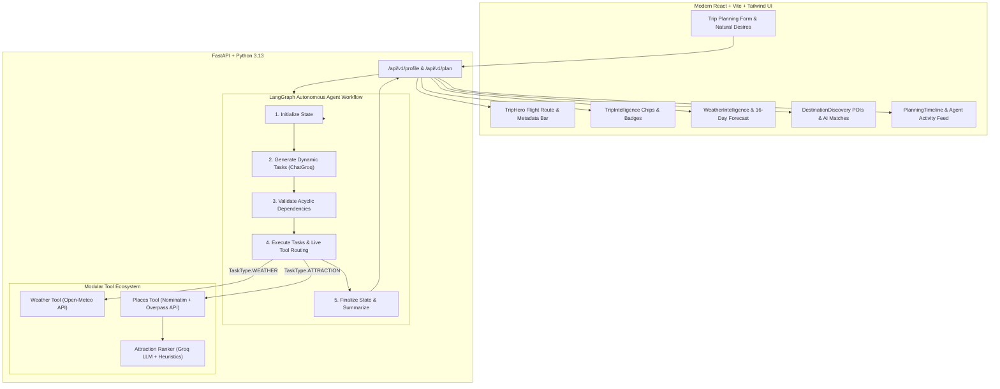

<div align="center">

# 🌍 TripMind AI

### Autonomous Agentic AI Travel Planning & Experience Discovery Platform

[](https://fastapi.tiangolo.com)
[](https://langchain-ai.github.io/langgraph/)
[](https://groq.com)
[](https://react.dev)
[](https://tailwindcss.com)
[](https://www.openstreetmap.org)
[](https://open-meteo.com)
[](LICENSE)

<p align="center">
  <b>TripMind AI</b> is an autonomous, agentic travel planning engine built with <b>LangGraph</b>, <b>Groq LLM</b>, <b>Open-Meteo</b>, and <b>OpenStreetMap</b>. It transforms natural travel intents into dependency-sequenced planning graphs, evaluates live meteorological data, discovers verified geographical points of interest, and personalizes recommendations with strict zero-hallucination guarantees.
</p>

[Key Features](#-key-features) • [Architecture](#-system-architecture) • [Phases Roadmap](#-phases-roadmap) • [Tech Stack](#-tech-stack) • [Quick Start](#-quick-start) • [Testing](#-test-suite)

</div>

---

## 🚀 Key Features

* **🧠 LangGraph Autonomous Task Decomposition**: Dynamically breaks down trips into dependency-ordered graphs factoring in duration, budget level, traveler dynamics (solo, couples, families with kids, seniors), and natural language constraints.
* **☀️ Live Meteorological Intelligence (Open-Meteo)**: Real-time 16-day daily forecasts (temperature ranges, precipitation probability, weather conditions, wind speeds) without fabricating fake forecasts for dates beyond meteorological limits.
* **📍 Verified Places & POIs Discovery (OpenStreetMap + Overpass API)**: Discovers real historical landmarks, museums, scenic viewpoints, nature parks, and cultural venues using open geospatial queries.
* **🎯 Preference & Weather-Aware Attraction Ranking**: Groq LLM evaluates and scores real places ($0-100\%$) based on user style, pace, and active weather context (e.g. prioritizing indoor venues during rain) with a strict anti-hallucination policy.
* **✨ Modern Dark Travel-AI UI**: Crafted with a dark palette (`#060911`, `#0a0f1d`), glassmorphism, Framer Motion transitions, interactive flight route hero, and expandable recommendation cards.
* **🛡️ Bulletproof Resilience & Graceful Fallbacks**: Multi-endpoint Overpass QL execution with Nominatim POI secondary resilience and heuristic tag ranking fallback if LLM or network limits occur.

---

## 🏛️ System Architecture



---

## 🧭 Phases Roadmap

| Phase | Module | Status | Highlights |
| :--- | :--- | :---: | :--- |
| **Phase 1** | Foundation & Validation | ✅ Completed | React + Vite frontend, FastAPI backend, Pydantic validation schemas. |
| **Phase 2** | Groq LLM Trip Analyzer | ✅ Completed | Centralized ChatGroq service, structured `TripAnalysis`, budget tiering. |
| **Phase 3** | Natural Language Preferences | ✅ Completed | Few-shot extraction, travel mood, pace, party dynamics, `EnhancedTripProfile`. |
| **Phase 4** | LangGraph Planning Agent | ✅ Completed | Autonomous task decomposition, dependency graph execution, execution trace. |
| **Phase 5** | Live Weather Intelligence | ✅ Completed | Open-Meteo integration, 16-day forecast horizon, Groq packing & activity tips. |
| **Phase 6** | Real Places & POIs Intelligence | ✅ Completed | OpenStreetMap Overpass POI engine, preference-aware ranking, Destination Discovery. |
| **Phase 7** | Accommodations & Lodging | ⏳ Upcoming | Real accommodation scoring and proximity filtering. |
| **Phase 8** | Transit & Route Optimization | ⏳ Upcoming | Inter-city and intra-city route connectivity optimization. |
| **Phase 9** | Day-by-Day Itinerary Engine | ⏳ Upcoming | Automated day-wise sequencing with interactive schedule export. |

---

## 🛠️ Tech Stack

### Frontend
- **Framework**: React 18 (Vite)
- **Styling**: Tailwind CSS (Tailored dark palette, glowing accents)
- **Animations**: Framer Motion
- **Icons**: Lucide React
- **HTTP Client**: Axios

### Backend
- **Framework**: FastAPI (Asynchronous Python 3.13)
- **Data Validation**: Pydantic v2
- **Agent Orchestration**: LangGraph, LangChain Core
- **LLM Engine**: Groq Cloud (`langchain-groq`, `openai/gpt-oss-120b` / Llama-3 models)
- **HTTP Client**: HTTPX (Async)
- **Geospatial & POIs**: OpenStreetMap Nominatim, Overpass API QL
- **Meteorology**: Open-Meteo Forecast & Geocoding APIs

---

## 📦 Project Structure

```text
TripMind AI/
├── backend/
│   ├── app/
│   │   ├── agents/
│   │   │   ├── agent_state.py          # TypedDict LangGraph state
│   │   │   └── planner_agent.py        # LangGraph state graph & tool routing
│   │   ├── api/
│   │   │   └── v1/
│   │   │       ├── api.py              # API router aggregation
│   │   │       └── endpoints/
│   │   │           ├── trip.py         # Phase 1 & 2 analysis endpoints
│   │   │           ├── preferences.py  # Phase 3 profile extraction endpoint
│   │   │           └── plan.py         # Phase 4-6 autonomous planning endpoint
│   │   ├── prompts/
│   │   │   ├── trip_analysis_prompt.py
│   │   │   ├── preferences_prompt.py
│   │   │   └── planner_prompt.py
│   │   ├── schemas/
│   │   │   ├── trip.py                 # Trip input models
│   │   │   ├── trip_analysis.py        # Structured analysis models
│   │   │   ├── travel_preferences.py   # Enhanced profile models
│   │   │   ├── weather.py              # Meteorological models
│   │   │   ├── places.py               # Places, POIs & Ranked Attraction models
│   │   │   └── travel_plan.py          # Planning task & response schemas
│   │   ├── services/
│   │   │   ├── llm_service.py          # Centralized ChatGroq instance
│   │   │   ├── trip_analyzer.py
│   │   │   ├── preference_extractor.py
│   │   │   ├── weather_service.py      # Async Open-Meteo client
│   │   │   ├── places_service.py       # Async Nominatim + Overpass POI engine
│   │   │   ├── attraction_ranker.py    # Preference & weather-aware ranker
│   │   │   └── planning_service.py     # Graph execution wrapper
│   │   ├── tools/
│   │   │   ├── weather_tool.py         # Weather tool interface & LLM insights
│   │   │   └── places_tool.py          # Places tool interface
│   │   ├── config.py                   # Environment & settings
│   │   └── main.py                     # FastAPI entrypoint & CORS
│   ├── tests/
│   │   ├── test_phase2.py
│   │   ├── test_phase3.py
│   │   ├── test_phase4.py
│   │   ├── test_phase5.py
│   │   └── test_phase6.py              # Complete Phase 6 test suite
│   ├── .env.example
│   └── requirements.txt
│
├── frontend/
│   ├── src/
│   │   ├── components/
│   │   │   ├── AgentActivity.jsx       # Terminal-style execution trace
│   │   │   ├── AgentPlanning.jsx       # Agent planning breakdown
│   │   │   ├── DestinationDiscovery.jsx# Real POIs & Ranked Attractions UI
│   │   │   ├── EnhancedTripProfile.jsx # Profile overview & CTA
│   │   │   ├── Features.jsx            # Product features
│   │   │   ├── Footer.jsx
│   │   │   ├── Hero.jsx                # Landing hero
│   │   │   ├── HowItWorks.jsx
│   │   │   ├── Navbar.jsx              # Dark glassmorphic navigation
│   │   │   ├── PlanningTaskList.jsx    # Decomposed task cards
│   │   │   ├── PlanningTimeline.jsx    # Orchestration timeline
│   │   │   ├── TripForm.jsx            # Form & interactive narrative flow
│   │   │   ├── TripHero.jsx            # Flight route hero header
│   │   │   ├── TripIntelligence.jsx    # High-density intelligence tags
│   │   │   ├── WeatherForecast.jsx     # Daily forecast grid with weather icons
│   │   │   └── WeatherIntelligence.jsx # Weather intelligence card
│   │   ├── pages/
│   │   │   └── Home.jsx
│   │   ├── index.css
│   │   └── main.jsx
│   ├── package.json
│   └── tailwind.config.js
│
├── .gitignore
└── README.md
```

---

## ⚡ Quick Start

### Prerequisites
- **Python 3.11+** (Tested on Python 3.13)
- **Node.js 18+** & `npm`
- **Groq API Key** (Get free at [console.groq.com](https://console.groq.com))

---

### 1. Backend Setup

```bash
# Navigate to backend directory
cd backend

# Create and activate virtual environment
python -m venv venv
# On Windows:
.\venv\Scripts\activate
# On macOS/Linux:
source venv/bin/activate

# Install dependencies
pip install -r requirements.txt

# Configure environment variables
cp .env.example .env
```

Edit `backend/.env`:
```env
GROQ_API_KEY=gsk_your_actual_groq_api_key_here
GROQ_MODEL=openai/gpt-oss-120b
PROJECT_NAME="TripMind AI"
ENVIRONMENT=development
PORT=8000
```

Start the backend server:
```bash
uvicorn app.main:app --reload --port 8000
```
Backend API will be live at: `http://localhost:8000` (Swagger docs at `http://localhost:8000/docs`).

---

### 2. Frontend Setup

```bash
# Navigate to frontend directory
cd frontend

# Install packages
npm install

# Start Vite development server
npm run dev
```
Frontend UI will be live at: `http://localhost:5173`.

---

## 🧪 Test Suite

TripMind AI features comprehensive end-to-end and unit tests across all phases using `pytest`:

```bash
cd backend

# Run all test suites
pytest tests/ -v

# Run specific Phase 6 tests
pytest tests/test_phase6.py -v
```

### Test Coverage Highlights:
- ✅ **Geocoding & Overpass**: Valid coordinates, radius bounds, OpenStreetMap normalization.
- ✅ **Network Resilience**: 504 gateway timeout resilience, multi-mirror failover, Nominatim POI secondary fallback.
- ✅ **Weather & Group Sensitivity**: Verifies weather caveats for outdoor activities during rain forecasts.
- ✅ **Anti-Hallucination Checks**: Verifies that 100% of ranked places originate from verified OpenStreetMap IDs.

---

## 🛡️ Honesty & Anti-Hallucination Policy

TripMind AI is engineered under strict **zero-fabrication standards**:
1. **Weather Truthfulness**: Live metrics are retrieved strictly from Open-Meteo. For trips beyond the 16-day forecast horizon, the system reports status transparently without making up fake temperatures.
2. **Attraction Truthfulness**: All place names, coordinates, and categories originate from OpenStreetMap. The LLM is restricted strictly to scoring and reasoning over verified IDs.
3. **Transparent State Tracking**: Downstream stages (Hotels, Flights, Day-Wise Itineraries) remain explicitly labeled as *Planned* until their respective real tools are integrated.

---

## 📄 License

Distributed under the **MIT License**. See `LICENSE` for more information.

---

<div align="center">
  <b>Built with ❤️ for intelligent, autonomous travel experiences.</b>
</div>
