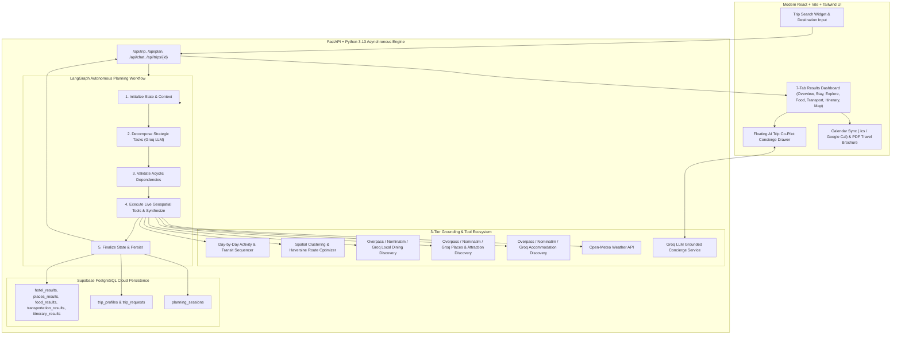

<div align="center">

# 🌍 TripMind AI

### Autonomous Agentic Travel Planning, Real-Time Intelligence & In-Trip Concierge Platform

[](https://fastapi.tiangolo.com)
[](https://langchain-ai.github.io/langgraph/)
[](https://groq.com)
[](https://supabase.com)
[](https://react.dev)
[](https://tailwindcss.com)
[](https://www.openstreetmap.org)
[](https://open-meteo.com)
[](LICENSE)

<p align="center">
  <b>TripMind AI</b> is an autonomous travel planning engine built with <b>LangGraph</b>, <b>Groq LLMs</b>, <b>OpenStreetMap</b>, <b>Open-Meteo</b>, and <b>Supabase</b>. It decomposes natural travel requests into dependency-sequenced execution graphs, discovers real accommodations, attractions, and authentic dining spots with 3-tier grounding resilience, computes intelligent route corridors, generates sequenced daily itineraries, provides calendar sync & printable brochures, and offers a real-time AI Trip Co-Pilot concierge.
</p>

[Key Features](#-key-features) • [System Architecture](#-system-architecture) • [Results Dashboard](#-interactive-results-experience) • [Phases & Roadmap](#-completed-phases--architecture) • [Tech Stack](#-tech-stack) • [Quick Start](#-quick-start) • [Export & Co-Pilot](#-calendar-sync-pdf-export--ai-co-pilot)

</div>

---

## 🚀 Key Features

* **🧠 LangGraph Autonomous Task Decomposition**: Dynamically breaks down trips into dependency-ordered graphs factoring in duration, budget tier, traveler dynamics (solo, couples, families with kids, seniors), and natural language constraints.
* **🏨 Real Accommodations & Scoring (OpenStreetMap + Groq)**: Discovers genuine hotels, boutique resorts, and heritage stays with live coordinates, external OpenStreetMap links, and personalized suitability scoring.
* **📍 Verified Sights & POI Discovery**: Discovers cultural monuments, museums, viewpoints, and nature spots using Overpass API with secondary Nominatim and Groq LLM real-world fallback layers.
* **🍲 Authentic Local Dining & Culinary Intelligence**: Pinpoints traditional restaurants, cafes, and thali halls with cuisine tags, dietary compatibility, and distance calculations from your lodging.
* **🚗 Route Optimization & Transit Guidance**: Automatically clusters nearby attractions using Haversine distance, partitioning days into geographic hubs with recommended transit modes (walk, cab, taxi, private vehicle) and actionable transit tips.
* **📅 Complete Day-by-Day Itineraries**: Synthesizes structured schedules with realistic morning, afternoon, and evening activity slots, dining bookings, and weather adjustments.
* **📆 One-Click Calendar Sync (`.ics` & Google Calendar)**: Generates universal RFC-5545 `.ics` files compatible with Apple, Google, and Outlook calendars, plus individual `+ Cal` quick-add buttons.
* **📄 Print-Ready Luxury PDF Travel Brochure**: Dedicated publication-grade print view (`window.print()` / Save as PDF) featuring trip parameters, hotel details, and daily schedules.
* **💬 Floating AI Trip Co-Pilot (Concierge Chat)**: In-page interactive assistant grounded in the traveler's active destination, hotel, weather, and schedule, with dynamic follow-up suggestion chips.
* **💾 Supabase Session Persistence**: Automatically stores trip requests, profiles, weather forecasts, stays, attractions, transit routes, and itineraries for instant recall.

---

## 🏛️ System Architecture



---

## 📱 Interactive Results Experience

TripMind AI renders a rich, modern 7-tab journey dashboard for any planned destination:

1. **Overview Tab**: Executive trip summary, budget allocation, traveler dynamics, and quick-jump highlight cards.
2. **Stay Tab**: Curated accommodations ranked by budget and location, with verified OpenStreetMap coordinates and AI selection rationale.
3. **Explore Tab**: Authentic cultural monuments, heritage sites, and scenic landmarks with high-resolution imagery.
4. **Food Tab**: Local gastronomy, traditional eateries, cafes, and bakeries with dietary match indicators and distances.
5. **Transport Tab**: Geographic hub partitions, leg-by-leg transit corridors (walking, taxi, cab, private vehicle), and local transit advice.
6. **Itinerary Tab**: Day-by-day chronological schedule with morning sightseeing, relaxed afternoons, and evening dining slots.
7. **Map Tab**: Interactive Leaflet / OpenStreetMap view displaying hotels, sights, and dining pins with live external links.

---

## 📅 Calendar Sync, PDF Export & AI Co-Pilot

### 1. Calendar Sync (`.ics` & Google Calendar)
- **Universal `.ics` Export**: Click **"Sync Calendar (.ics)"** on the Itinerary tab to export an RFC-5545 `.ics` file containing all scheduled activities with exact start/end times and transit details.
- **Individual Google Calendar Links**: Click **"+ Cal"** on any activity card to add that specific event directly to Google Calendar.

### 2. Print & Save as PDF Travel Brochure
- Click **"Print / PDF"** (or press `Ctrl+P`) to generate an editorial, publication-quality printable document with cover details, anchor accommodation, and day-by-day activity timelines.

### 3. AI Trip Co-Pilot (Concierge Chat Drawer)
- Click the floating **"Trip Co-Pilot"** button in the bottom-right corner.
- Ask questions about:
  - Packing lists based on destination weather
  - Vegetarian / specific cuisine near your anchor hotel
  - Pacing and walking strain for children or seniors
  - Local customs, tips, and hidden gems

---

## 🧭 Completed Phases & Architecture

| Phase | Module | Status | Highlights |
| :--- | :--- | :---: | :--- |
| **Phase 1** | Foundation & Validation | ✅ Completed | React + Vite frontend, FastAPI backend, Pydantic validation schemas. |
| **Phase 2** | Groq LLM Trip Analyzer | ✅ Completed | Centralized ChatGroq service, structured `TripAnalysis`, budget tiering. |
| **Phase 3** | Natural Language Preferences | ✅ Completed | Few-shot extraction, travel mood, pace, party dynamics, `EnhancedTripProfile`. |
| **Phase 4** | LangGraph Planning Agent | ✅ Completed | Autonomous task decomposition, dependency graph execution, execution trace. |
| **Phase 5** | Live Weather Intelligence | ✅ Completed | Open-Meteo integration, 16-day forecast horizon, Groq packing & activity tips. |
| **Phase 6** | Real Places & POIs Intelligence | ✅ Completed | OpenStreetMap Overpass POI engine, preference-aware ranking, Destination Discovery. |
| **Phase 7** | Accommodations & Lodging | ✅ Completed | Real accommodation scoring, OpenStreetMap geodata, lodging suitability notes. |
| **Phase 8** | Transit & Route Optimization | ✅ Completed | Spatial clustering, Haversine corridors, transit mode guidance, and mobility overrides. |
| **Phase 9** | Day-by-Day Itinerary Engine | ✅ Completed | Chronological daily sequencing, food integration, and weather responsiveness. |
| **Phase 10**| Session Persistence | ✅ Completed | Supabase PostgreSQL schema and automatic snapshot saving. |
| **Phase 11**| Export & Calendar Sync | ✅ Completed | Universal `.ics` file generation and Google Calendar event URLs. |
| **Phase 12**| AI Trip Co-Pilot Concierge | ✅ Completed | Real-time chat drawer powered by Groq LLM grounded in current trip context. |

---

## 🛠️ Tech Stack

### Frontend
- **Framework**: React 18 (Vite)
- **Styling**: Tailwind CSS (Tailored travel design system, cream & forest green palettes)
- **Icons**: Lucide React
- **Maps**: Leaflet & OpenStreetMap
- **Utilities**: Custom iCalendar RFC-5545 generator, print brochure engine

### Backend
- **Framework**: FastAPI (Asynchronous Python 3.13)
- **Validation**: Pydantic v2
- **Agent Orchestration**: LangGraph, LangChain Core
- **LLM Provider**: Groq Cloud (`llama-3.3-70b-versatile`)
- **Geospatial & POIs**: OpenStreetMap Nominatim, Overpass API QL
- **Meteorology**: Open-Meteo Forecast & Geocoding APIs
- **Database / Storage**: Supabase (PostgreSQL with JSONB schemas)

---

## ⚡ Quick Start

### Prerequisites
- **Python 3.11+** (Tested on Python 3.13)
- **Node.js 18+** & `npm`
- **Groq API Key** (Free at [console.groq.com](https://console.groq.com))
- **Supabase Account** (Optional, for persistent trip history)

---

### 1. Backend Setup

```bash
# Navigate to backend directory
cd backend

# Create and activate virtual environment
python -m venv venv
# On Windows:
.\venv\Scripts\activate
# On macOS/Linux:
source venv/bin/activate

# Install dependencies
pip install -r requirements.txt

# Configure environment variables
cp .env.example .env
```

Edit `backend/.env`:
```env
GROQ_API_KEY=gsk_your_actual_groq_api_key_here
GROQ_MODEL=llama-3.3-70b-versatile
PROJECT_NAME="TripMind AI"
ENVIRONMENT=development
PORT=8000
SUPABASE_URL=https://your-project.supabase.co
SUPABASE_KEY=your_supabase_anon_key
```

Start the backend server:
```bash
uvicorn app.main:app --reload --port 8000
```
Backend API will be live at: `http://localhost:8000` (Swagger docs at `http://localhost:8000/docs`).

---

### 2. Frontend Setup

```bash
# Navigate to frontend directory
cd frontend

# Install packages
npm install

# Start Vite development server
npm run dev
```
Frontend UI will be live at: `http://localhost:5173`.

---

## 🧪 Testing & Verification

TripMind AI features comprehensive tests and verification tools:

```bash
cd backend

# Run automated tests
pytest tests/ -v

# Run persistence verification
python tests/test_persistence.py

# Test full end-to-end planning workflow
python -c "
import asyncio
from app.services.planning_service import planning_service
from app.schemas.travel_preferences import EnhancedTripProfile
from app.schemas.trip import TripCreate
from app.schemas.trip_analysis import TripAnalysis, BudgetLevel

async def test():
    req = TripCreate(destination='Kashmir', origin='Delhi', departure_date='2026-10-01', return_date='2026-10-05', travelers=2, budget=50000)
    analysis = TripAnalysis(trip_summary='Scenic trip', duration_days=5, travel_style='Balanced', budget_per_traveler=25000, budget_per_day=10000, budget_level=BudgetLevel.MODERATE, accommodation_expectation='Standard hotel', notes='Autumn trip')
    profile = EnhancedTripProfile(trip_request=req, trip_analysis=analysis)
    res = await planning_service.create_travel_plan(profile)
    print('SUCCESS:', res.success, 'Places:', len(res.places_context.places), 'Hotels:', len(res.hotel_context.hotels))

asyncio.run(test())
"
```

---

## 🛡️ Honesty & Grounding Standard

TripMind AI enforces strict **data grounding standards**:
1. **Weather Truthfulness**: Live metrics are retrieved strictly from Open-Meteo. Beyond the 16-day forecast horizon, the system indicates seasonal climate averages without fabricating exact daily temperatures.
2. **Geographical Authenticity**: Sights, accommodations, and dining establishments are verified through OpenStreetMap and geocoded coordinates.
3. **3-Tier Grounding Resilience**: If public Overpass servers experience traffic limits, the engine gracefully activates Nominatim and Groq LLM authentic knowledge fallbacks.

---

## 📄 License

Distributed under the **MIT License**. See `LICENSE` for more information.

---

<div align="center">
  <b>Built with ❤️ for intelligent, autonomous travel experiences.</b>
</div>
