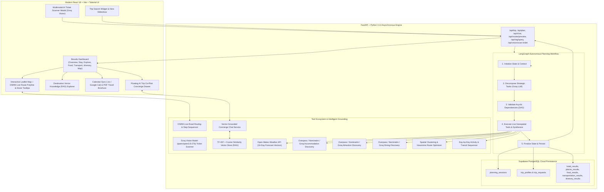

<div align="center">

# 🌍 TripMind AI

### Autonomous Agentic Travel Planning, Real-Time Grounded Intelligence, Vector RAG & In-Trip Concierge Platform

[](https://fastapi.tiangolo.com)
[](https://langchain-ai.github.io/langgraph/)
[](https://groq.com)
[](https://groq.com)
[](backend/data/knowledge_base/)
[](https://supabase.com)
[](https://leafletjs.com)
[](https://project-osrm.org)
[](LICENSE)

<p align="center">
  <b>TripMind AI</b> is an autonomous agentic travel planning engine built with <b>LangGraph</b>, <b>Groq LPUs</b>, <b>Multimodal Vision Models</b>, <b>Vector Database (RAG)</b>, <b>OSRM Road Routing</b>, <b>OpenStreetMap</b>, <b>Open-Meteo</b>, and <b>Supabase</b>. It decomposes natural travel goals into dependency-ordered Directed Acyclic Graphs (DAGs), scans travel tickets/vouchers via Vision AI, discovers real accommodations and dining spots, computes live street turn-by-turn road routes, generates sequenced daily itineraries, provides calendar sync & printable brochures, and offers a real-time AI Trip Co-Pilot concierge grounded in vector knowledge.
</p>

[Key Features](#-key-features) • [System Architecture](#-system-architecture) • [Results Dashboard](#-interactive-results-experience) • [Completed Phases](#-completed-phases--architecture) • [Tech Stack](#-tech-stack) • [Quick Start](#-quick-start) • [Documentation Suite](#-documentation-downloads)

</div>

---

## 🚀 Key Features

* **🧠 LangGraph Autonomous Task Decomposition**: Dynamically breaks down travel goals into dependency-ordered graphs factoring in duration, budget tier, traveler dynamics (solo, couples, families with kids, seniors), and natural language constraints.
* **📷 Multimodal AI Ticket & Booking Scanner (Groq Vision)**: Users can upload or drag-and-drop flight tickets, boarding passes, or hotel vouchers. The `qwen/qwen3.8-27b` multimodal vision model visually extracts the origin, destination, normalized dates, passenger counts, and booking PNR to auto-fill the planner.
* **🔍 Destination Knowledge Base Vector Database (RAG)**: Integrates a TF-IDF n-gram vector database computing Cosine Similarity over curated safety advisories, transit protocols, scam warnings, and visa requirements for destinations (Jaipur, Goa, Paris, Tokyo, Dubai).
* **💬 Grounded AI Trip Co-Pilot (Concierge Chat)**: In-page interactive assistant grounded in the traveler's active destination, hotel, and schedule, with direct vector retrieval preventing hallucinations on police numbers, scams, and metro rules.
* **🚗 Turn-by-Turn Live Road Routing & OSRM Engine**: Calculates real road corridors using Open Source Routing Machine (OSRM). Renders street polylines on Leaflet, total road distance (km), travel durations (mins), and step-by-step driving/walking maneuvers.
* **🗺️ Interactive Leaflet Map with Hover Tooltips**: Clean OpenStreetMap base layer with custom SVG markers for Stays (🟣), Sights (🟢), and Dining (🟠). Hovering your mouse over any marker instantly displays a floating tooltip with the place name and category!
* **🏨 Real Accommodations & Scoring (OpenStreetMap + Groq)**: Discovers genuine hotels, boutique resorts, and heritage stays with live coordinates, external OpenStreetMap links, and personalized suitability scoring.
* **📍 Verified Sights & POI Discovery**: Discovers cultural monuments, museums, viewpoints, and nature spots using Overpass API with secondary Nominatim and Groq LLM real-world fallback layers.
* **🍲 Authentic Local Dining & Culinary Intelligence**: Pinpoints traditional restaurants, cafes, and thali halls with cuisine tags, dietary compatibility, and distance calculations from your lodging.
* **📅 Complete Day-by-Day Itineraries**: Synthesizes structured schedules with realistic morning, afternoon, and evening activity slots, dining bookings, and weather adjustments.
* **📆 One-Click Calendar Sync (`.ics` & Google Calendar)**: Generates universal RFC-5545 `.ics` files compatible with Apple, Google, and Outlook calendars, plus individual `+ Cal` quick-add buttons.
* **📄 Print-Ready Luxury PDF Travel Brochure**: Dedicated publication-grade print view (`window.print()` / Save as PDF) featuring trip parameters, hotel details, and daily schedules.
* **💾 Supabase Cloud Persistence**: Automatically stores trip requests, profiles, weather forecasts, stays, attractions, transit routes, and itineraries for instant recall.

---

## 🏛️ System Architecture



---

## 📱 Interactive Results Experience

TripMind AI renders a rich journey dashboard for any planned destination:

1. **Overview Tab**: Executive trip summary, budget allocation, traveler dynamics, and quick-jump highlight cards.
2. **Stay Tab**: Curated accommodations ranked by budget and location, with verified OpenStreetMap coordinates and AI selection rationale.
3. **Explore Tab**: Authentic cultural monuments, heritage sites, and scenic landmarks with high-resolution imagery.
4. **Food Tab**: Local gastronomy, traditional eateries, cafes, and bakeries with dietary match indicators and distances.
5. **Transport Tab**: Geographic hub partitions, leg-by-leg transit corridors (walking, taxi, cab, private vehicle), and local transit advice.
6. **Itinerary Tab**: Day-by-day chronological schedule with morning sightseeing, relaxed afternoons, and evening dining slots.
7. **Packing & Prep Tab**: Dynamic, weather-aware packing checklist categorized into essentials, clothing, and travel readiness.
8. **Budget & Expenses Tab**: Itemized budget distribution (Accommodation, Dining, Sights, Transit, Buffer) with multi-currency converter.
9. **Map Tab**: Interactive Leaflet engine with OpenStreetMap basemap, day corridor selectors, OSRM live road routing with turn-by-turn guidance, **instant hover tooltips**, and a **Destination Vector Knowledge (RAG)** explorer panel.

---

## 🧭 Completed Phases & Architecture

| Phase | Module | Status | Highlights |
| :--- | :--- | :---: | :--- |
| **Phase 1** | Foundation & Validation | ✅ Completed | React + Vite frontend, FastAPI backend, Pydantic validation schemas. |
| **Phase 2** | Groq LLM Trip Analyzer | ✅ Completed | Centralized ChatGroq service, structured `TripAnalysis`, budget tiering. |
| **Phase 3** | Natural Language Preferences | ✅ Completed | Few-shot extraction, travel mood, pace, party dynamics, `EnhancedTripProfile`. |
| **Phase 4** | LangGraph Planning Agent | ✅ Completed | Autonomous task decomposition, dependency graph execution, execution trace. |
| **Phase 5** | Live Weather Intelligence | ✅ Completed | Open-Meteo integration, 16-day forecast horizon, Groq packing & activity tips. |
| **Phase 6** | Real Places & POIs Intelligence | ✅ Completed | OpenStreetMap Overpass POI engine, preference-aware ranking, Destination Discovery. |
| **Phase 7** | Accommodations & Lodging | ✅ Completed | Real accommodation scoring, OpenStreetMap geodata, lodging suitability notes. |
| **Phase 8** | Transit & Route Optimization | ✅ Completed | Spatial clustering, Haversine corridors, transit mode guidance, and mobility overrides. |
| **Phase 9** | Day-by-Day Itinerary Engine | ✅ Completed | Chronological daily sequencing, food integration, and weather responsiveness. |
| **Phase 10**| Session Persistence | ✅ Completed | Supabase PostgreSQL schema and automatic snapshot saving. |
| **Phase 11**| Export & Calendar Sync | ✅ Completed | Universal `.ics` file generation and Google Calendar event URLs. |
| **Phase 12**| AI Trip Co-Pilot Concierge | ✅ Completed | Real-time chat drawer powered by Groq LLM grounded in active trip parameters. |
| **Phase 13**| **Turn-by-Turn Road Routing (OSRM)** | ✅ Completed | Leaflet road polylines, distance (km), travel times (mins), and step maneuvers with hover tooltips. |
| **Phase 14**| **Destination Vector Database (RAG)** | ✅ Completed | TF-IDF n-grams + Cosine Similarity store grounding the concierge in unhallucinated safety/transit facts. |
| **Phase 15**| **Multimodal Vision Ticket Scanner** | ✅ Completed | `qwen/qwen3.8-27b` multimodal vision model parsing flight tickets, boarding passes, and vouchers. |

---

## 🛠️ Tech Stack

### Frontend
- **Framework**: React 18 (Vite)
- **Styling**: Tailwind CSS (Tailored travel design system, cream & forest green palettes)
- **Icons**: Lucide React
- **Maps & GIS**: Leaflet.js & OpenStreetMap Standard Tile Layer
- **Routing Engine**: Open Source Routing Machine (OSRM)
- **Utilities**: Custom iCalendar RFC-5545 generator, editorial print brochure engine

### Backend
- **Framework**: FastAPI (Asynchronous Python 3.13)
- **Validation**: Pydantic v2
- **Agent Orchestration**: LangGraph, LangChain Core
- **Fast LLM Provider**: Groq Cloud (`llama-3.3-70b-versatile` / `openai/gpt-oss-120b`)
- **Multimodal Vision**: Groq Cloud (`qwen/qwen3.8-27b`)
- **Vector Store & RAG**: `scikit-learn` & `numpy` (TF-IDF sublinear vectorization + Cosine Similarity)
- **Road Routing**: OSRM HTTP API integration
- **Geospatial & POIs**: OpenStreetMap Nominatim, Overpass API QL
- **Meteorology**: Open-Meteo Forecast & Geocoding APIs
- **Database / Storage**: Supabase (PostgreSQL with JSONB schemas)

---

## ⚡ Quick Start

### Prerequisites
- **Python 3.11+** (Tested on Python 3.13)
- **Node.js 18+** & `npm`
- **Groq API Key** (Free at [console.groq.com](https://console.groq.com))
- **Supabase Account** (Optional, for cloud trip persistence)

---

### 1. Backend Setup

```bash
# Navigate to backend directory
cd backend

# Create and activate virtual environment
python -m venv venv

# On Windows:
.\venv\Scripts\activate

# On macOS/Linux:
source venv/bin/activate

# Install dependencies
pip install -r requirements.txt

# Configure environment variables
cp .env.example .env
```

Edit `backend/.env`:
```env
GROQ_API_KEY=gsk_your_actual_groq_api_key_here
GROQ_MODEL=openai/gpt-oss-120b
PROJECT_NAME="TripMind AI"
ENVIRONMENT=development
PORT=8000
SUPABASE_URL=https://your-project.supabase.co
SUPABASE_KEY=your_supabase_anon_key
```

Start the backend server:
```bash
uvicorn app.main:app --reload --port 8000
```
Backend API live at `http://localhost:8000` (Interactive Swagger docs at `http://localhost:8000/docs`).

---

### 2. Frontend Setup

```bash
# Navigate to frontend directory
cd frontend

# Install packages
npm install

# Start Vite development server
npm run dev
```
Frontend UI live at `http://localhost:5173`.

---

## 📖 Documentation Downloads

For academic presentations, project viva defense, and comprehensive architectural review, the complete documentation is available in three formats:

* 📄 **[TripMind_AI_Feature_and_Architecture_Guide.docx](TripMind_AI_Feature_and_Architecture_Guide.docx)** — Microsoft Word document format ready to print or submit.
* 🌐 **[TripMind_AI_Feature_and_Architecture_Guide.html](TripMind_AI_Feature_and_Architecture_Guide.html)** — Formatted HTML view with an integrated "Save as PDF / Print" button.
* 📝 **[TripMind_AI_Feature_and_Architecture_Guide.md](TripMind_AI_Feature_and_Architecture_Guide.md)** — Comprehensive Markdown reference.

---

## 🛡️ Honesty & Grounding Standard

TripMind AI enforces strict **data grounding standards**:
1. **Weather Truthfulness**: Live metrics are retrieved strictly from Open-Meteo. Beyond the 16-day forecast horizon, the system indicates seasonal climate averages without fabricating exact daily temperatures.
2. **Geographical Authenticity**: Sights, accommodations, and dining establishments are verified through OpenStreetMap and geocoded coordinates.
3. **3-Tier Grounding Resilience**: If public Overpass servers experience traffic limits, the engine gracefully activates Nominatim and Groq LLM authentic knowledge fallbacks.
4. **Vector RAG Safety Grounding**: Concierge responses for local safety, scam warnings, and transit rules are strictly grounded in indexed destination guides via Cosine Similarity.
5. **Prompt Injection Defense**: All user instructions are isolated within `<USER_INPUT>` XML boundaries to prevent adversarial prompt injection attacks.

---

## 📄 License

Distributed under the **MIT License**. See `LICENSE` for more information.

---

<div align="center">
  <b>Built with ❤️ by Omkar Narsale for intelligent, autonomous travel experiences.</b>
</div>
